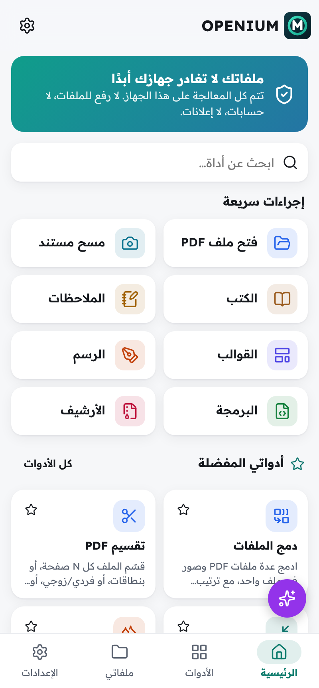
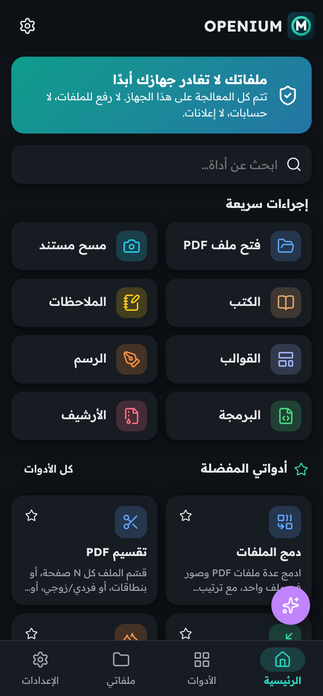
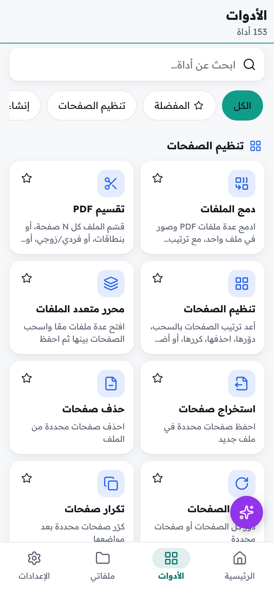
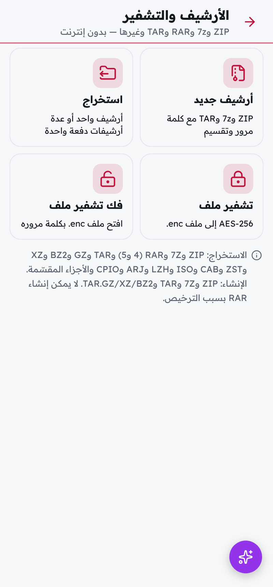
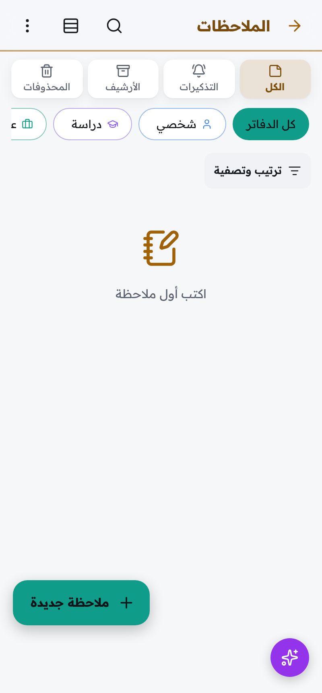
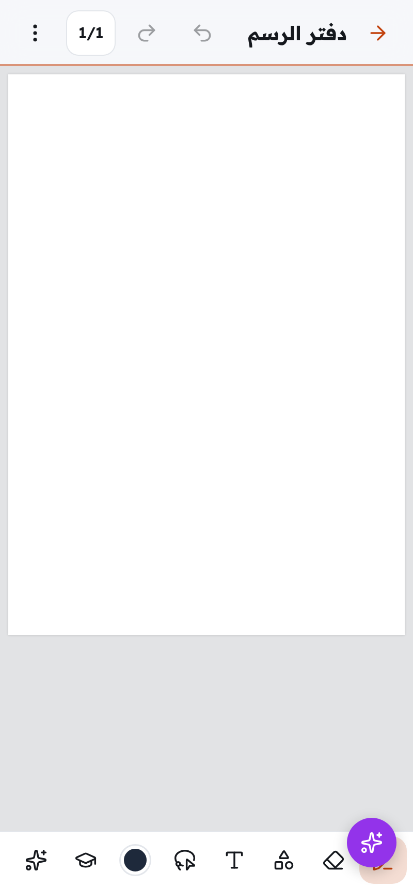
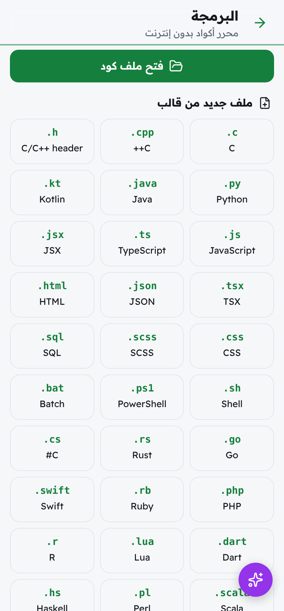
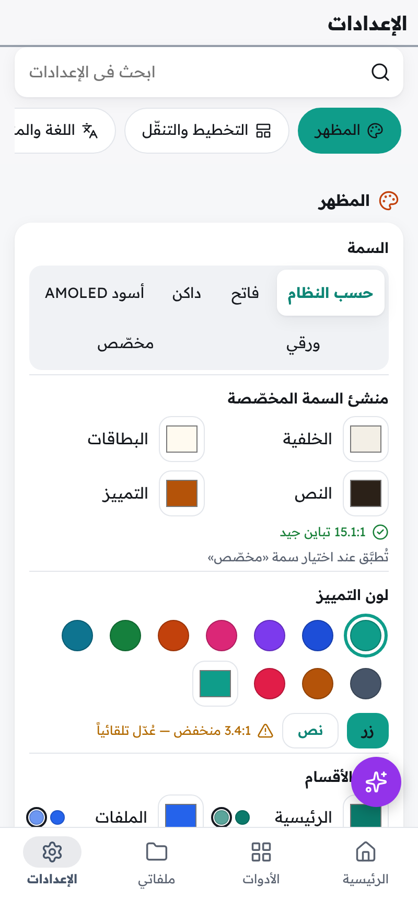

# OPENIUM

**مركز مستنداتك الكامل على هاتفك: يعمل بدون إنترنت، عربي أولاً**

**Your complete offline document centre for Android, Arabic first**

[**تنزيل أحدث إصدار / Download the latest release**](https://github.com/moha2nadr-cloud/OPENIUM/releases/latest)

أندرويد 8 أو أحدث · arm64 · بدون صلاحية إنترنت · بدون حسابات أو إعلانات أو تتبّع

[العربية](#لماذا-openium) · [English](#english)

---

## المحتويات

- [لماذا OPENIUM](#لماذا-openium)
- [حالة الميزات](#حالة-الميزات)
- [أدوات PDF](#أدوات-pdf)
- [محرك أوفيس](#محرك-أوفيس)
- [الكتب الإلكترونية](#الكتب-الإلكترونية)
- [المحررات الخفيفة](#المحررات-الخفيفة)
- [الأرشيفات وتشفير الملفات](#الأرشيفات-وتشفير-الملفات)
- [الماسح الضوئي وسلاسل العمل](#الماسح-الضوئي-وسلاسل-العمل)
- [الذكاء الاصطناعي على الجهاز](#الذكاء-الاصطناعي-على-الجهاز)
- [استوديو الصور](#استوديو-الصور)
- [الملاحظات](#الملاحظات)
- [الرسم للطلاب](#الرسم-للطلاب)
- [محرر الشيفرة](#محرر-الشيفرة)
- [مدير الملفات والواجهة](#مدير-الملفات-والواجهة)
- [الإعدادات](#الإعدادات)
- [الخصوصية](#الخصوصية)
- [العربية أولا](#العربية-أولا)
- [التنزيل والتثبيت](#التنزيل-والتثبيت)
- [تفعيل الذكاء الاصطناعي خطوة بخطوة](#تفعيل-الذكاء-الاصطناعي-خطوة-بخطوة)
- [الأسئلة الشائعة](#الأسئلة-الشائعة)
- [English](#english)

---

## لماذا OPENIUM

- **خصوصية تامة:** التطبيق لا يطلب صلاحية الإنترنت أصلاً. كل المعالجة تتم على جهازك، ولا يُرفع أي ملف إلى أي خادم. لا حسابات، لا إعلانات، لا تتبّع.
- **عربي أولاً:** الواجهة كلها من اليمين إلى اليسار، والنصوص العربية مُشكَّلة وموصولة في كل الأدوات: القراءة، التحرير، التحويل، التعرّف الضوئي، القراءة الصوتية والذكاء الاصطناعي. يدعم أيضاً الإنجليزية والتركية.
- **كل شيء في تطبيق واحد:** PDF، وورد، إكسل، باوربوينت، الكتب الإلكترونية، الصور، الملاحظات، الرسم، ملفات البرمجة والأرشيفات.
- **كل شيء مضمَّن:** الخطوط، قواميس التدقيق الإملائي، لغات التعرّف الضوئي، الأصوات، نماذج تحسين الصور ونماذج الترجمة موجودة داخل التطبيق. لا يُنزَّل أي شيء أثناء الاستخدام.

  

---

## حالة الميزات

هذه الصفحة تصف ما يحتويه التطبيق بصدق. كل ميزة في قائمة العمل الداخلية لها واحدة من هذه الحالات:

| العلامة في هذه الصفحة | المعنى |
|---|---|
| بلا علامة | **مكتملة:** مبنية ومُختبَرة (اختبارات آلية و/أو تجربة على ملفات حقيقية، وبالعربية). |
| **[تجريبي]** | **مبنية لكن لم يُتحقَّق منها بعد على هاتف حقيقي.** موجودة في التطبيق، وقد تحتوي على أخطاء أو تكون أبطأ من المتوقع. |
| **[مخطط]** | **لم يبدأ العمل عليها بعد** أو ما زالت في قائمة العمل. مذكورة هنا لتعرف ما هو قادم، وليست جزءاً مضموناً من الإصدار الحالي. |
| **[أُزيلت]** | أُزيلت عمداً، والسبب مذكور (غالباً لأنها تحتاج الإنترنت). |

ملاحظات مهمة:

- معظم الاختبارات أُجريت آلياً وعلى ملفات حقيقية داخل محرّك المتصفح الذي يعمل عليه التطبيق، وليس كل ميزة جُرِّبت يدوياً على هاتف بعد. حيث لم يحدث ذلك، تجد العلامة **[تجريبي]**.
- **محرّك نموذج اللغة (LLM)** الذي يشغّل المساعد والتلخيص والأسئلة والبطاقات لم يُختبَر بعد على هاتف حقيقي. لذلك اعتبِر كل ميزات نموذج اللغة تجريبية، حتى تلك المكتملة من ناحية الواجهة.
- تحسينات الأداء (تعدد الخيوط، سرعة الإقلاع) قِيست في محرّك Chromium، ولم تُقَس بعد على الهاتف.

---

## أدوات PDF

أكثر من 140 أداة، تعمل كلها على الجهاز. كل أداة يمكن تشغيلها على ملف واحد أو على عدة ملفات دفعة واحدة، مع معاينة النتيجة قبل الحفظ واختيار مكان الحفظ.

<b>تنظيم الصفحات</b> (36 أداة)

- دمج ملفات مع إعادة الترتيب بالسحب، ونطاق صفحات لكل ملف، وإشارة مرجعية باسم كل ملف مدموج.
- الدمج المتداخل (صفحة من كل ملف بالتناوب، مع عكس الملف الثاني لمسح الوجهين).
- محرّر تجميع متعدد الملفات: اسحب الصفحات بين الملفات ثم احفظ.
- التقسيم: كل N صفحة، نطاقات مخصصة، فردي/زوجي، حسب الإشارات المرجعية (مع اختيار المستوى)، حسب حجم الملف، عند الصفحات الفارغة، عند صفحات فاصلة برمز QR، عند ظهور نص معيّن.
- قسمة الصفحة إلى نصفين (صفحتان ممسوحتان على ورقة واحدة).
- استخراج الصفحات، حذفها، تكرارها، عكس ترتيبها، نقل صفحة إلى موضع، ترتيب الصفحات.
- إدراج صفحة فارغة أو صورة أو صفحات من ملف آخر، ونسخ الصفحات ولصقها بين الملفات، ومشاركة صفحات مختارة.
- التدوير اليدوي (صفحة أو الكل) والتدوير التلقائي حسب اتجاه النص المكتشف.
- عدة صفحات في ورقة (2، 4، 6، 8، 9، 16)، تجهيز كتيّب للطباعة (مع خيار التجليد من اليمين)، تقسيم ملصق كبير على أوراق A4 مع تداخل وعلامات قص، دمج كل الصفحات في صفحة طويلة واحدة.
- قص الهوامش يدوياً، وقص الهوامش البيضاء تلقائياً.
- تغيير مقاس الصفحة وتوحيد المقاسات المختلفة، إضافة هوامش، تكبير/تصغير المحتوى.
- تراكب ملفين (ورق رسمي تحت المحتوى أو فوقه).
- حذف الصفحات الفارغة مع ضبط الحساسية، وقلب الصفحات أفقياً أو عمودياً.

<b>الإنشاء والتحويل إلى PDF</b>

- صور إلى PDF (JPG، PNG، WebP، GIF، BMP، SVG) مع المقاس والاتجاه والهوامش والجودة وعدد الصور في الصفحة.
- HEIC/HEIF إلى PDF، وTIFF متعدد الصفحات إلى PDF.
- الماسح بالكاميرا: اكتشاف الحواف وتصحيح المنظور، فلاتر (أبيض وأسود، رمادي، تحسين، إزالة الظلال)، إزالة الأصابع من حواف الكتب، المسح المتعدد، وضع الكتاب (فصل الصفحتين وتصحيح الانحناء)، وضع بطاقة الهوية (الوجهان في صفحة)، وضع الإيصال الطويل، واكتشاف عدة صور ممسوحة معاً وفصلها.
- محرّر نصوص منسّقة إلى PDF (عربي أولاً)، ونص عادي، وMarkdown، وRTF، وHTML، وصفحة ويب محفوظة (HTML/MHTML)، وXML/JSON/شيفرة برمجية مع تلوين.
- EPUB وFB2 وMOBI وXPS وCBZ إلى PDF، وملف ZIP من صور أو مستندات إلى PDF، ورسالة بريد EML إلى PDF.
- وورد (DOCX/DOC) وإكسل (XLSX/XLS/ODS/CSV) وباوربوينت (PPTX/ODP) وODT وODG/Publisher إلى PDF. **[تجريبي]** هذه التحويلات تنتقل إلى محرّك LibreOffice المدمج، ويبقى المحوّل الحالي احتياطياً.
- أوراق جاهزة: فارغة، مسطّرة، منقّطة، مربعات، رسم بياني، مدرّج موسيقي، كورنيل، تقويم.
- منشئ سيرة ذاتية، منشئ طلب توظيف (خطاب تقديم وسيرة ومرفقات)، منشئ فواتير، فاتورة إلكترونية (Factur-X/ZUGFeRD بصيغة PDF/A-3)، بطاقات تهنئة ودعوات، مجمّع صور (كولاج).
- مولّد رموز QR بتنسيق (ألوان، شعار، نقاط)، ومولّد كلمات مرور قوية.

<b>التحويل من PDF</b>

- PDF إلى PNG وJPG وWebP (مع الدقة ونطاق الصفحات وحزمة ZIP)، وTIFF متعدد الصفحات، وSVG، وGIF، وBMP.
- كل الصفحات في صورة واحدة طويلة (مناسبة لواتساب).
- استخراج الصور المضمّنة بجودتها الأصلية.
- PDF إلى نص (عادي أو مع الحفاظ على التخطيط) مع إصلاح النص العربي المعكوس أو المفصول، وإلى Markdown وHTML وRTF وEPUB وCBZ.
- PDF إلى وورد/ODT، وإكسل/ODS/CSV (الجداول)، وباوربوينت/ODP. **[تجريبي]** تنتقل إلى محرّك LibreOffice.
- استخراج جدول من منطقة محددة إلى إكسل أو CSV.
- النسخ الذكي: المس فقرة أو جدولاً أو قائمة أو صورة لنسخها، ويعمل على الصفحات الممسوحة عبر التعرّف الضوئي.
- PDF إلى PDF/A-1b/2b/3b، وPDF/X للطباعة.
- PDF إلى ملف صوتي (قراءة بصوت طبيعي إلى ملف m4a، مع تشكيل النص العربي تلقائياً).

<b>الضغط والتحسين</b>

- مستويات ضغط جاهزة (منخفض، متوسط، عالٍ، أقصى) وضغط مخصص (دقة الصور، جودة JPEG).
- تحويل الصور إلى رمادي أو أبيض وأسود، تضمين جزء الخطوط المستخدم فقط، إزالة الكائنات المكررة.
- إزالة البيانات غير الضرورية (البيانات الوصفية، الصور المصغرة، JavaScript، بيانات التطبيقات).
- **الضغط إلى حجم محدد** (يبحث تلقائياً عن الجودة والدقة المناسبتين)، مع معاينة الحجم والجودة قبل وبعد.
- إصلاح الملفات التالفة، التحسين للعرض السريع على الويب (Linearize).
- تسطيح النماذج والتعليقات، وتحويل الصفحات إلى صور لمنع النسخ.

<b>تحرير المحتوى والتعليقات</b>

- **تحرير النص الموجود** مع مطابقة الخط والحجم واللون، وتحرير الصور الموجودة (تدوير، قص، استبدال، استخراج، حذف).
- إضافة نص (عربي مُشكَّل، خطوط، حجم، لون، محاذاة) وإضافة صور.
- أشكال: مستطيل، بيضاوي، خط، سهم، مضلّع، خط متعدد، سحابة.
- رسم حر بالقلم مع الضغط والتنعيم، وتبييض (Whiteout).
- تظليل بعدة ألوان، تسطير، شطب، خط متموّج.
- ملاحظات لاصقة، مربعات نص، تعليقات بأسهم، **تعليقات صوتية**.
- إضافة الروابط وتعديلها وحذفها (عنوان ويب أو صفحة).
- أختام جاهزة (معتمد، مسودة، سري، مدفوع، مرفوض، عاجل...) بالعربية والإنجليزية والتركية، وأختام مخصصة بالتاريخ والوقت والاسم، وملصقات ورموز (علامة صح، خطأ، نقطة، نجمة، أسهم).
- قياس المسافة والمحيط والمساحة بمقياس رسم.
- ضبط السطوع والتباين والتشبع، عكس الألوان، استبدال لون بآخر.
- حذف كل التعليقات، حذف كل الصور، حذف النص المخفي.
- تراجع وإعادة بلا حدود، تحديد التعليقات وتحريكها وتعديل خصائصها.
- قائمة مراجعة التعليقات (تصفية حسب الكاتب والنوع) وتصديرها، واستيراد/تصدير التعليقات بصيغة XFDF.

<b>تزيين الصفحات</b>

- علامة مائية نصية (الشفافية، الزاوية، الموضع، تكرار شبكي، أمام/خلف المحتوى، الصفحات) وعلامة مائية بصورة.
- اكتشاف العلامات المائية الموجودة وإزالتها.
- ترقيم الصفحات بصيغ متعددة (n، n/N، صفحة n من N، روماني، حروف)، بأرقام عربية أو غربية، مع تخطّي الغلاف ورقم البداية والموضع.
- ترويسة وتذييل: اسم الملف، التاريخ الهجري أو الميلادي، نص مخصص، رموز الصفحات.
- ترقيم Bates (بادئة، عدد الخانات، لاحقة، رقم البداية).
- إطار للصفحة، لون أو صورة خلفية، رمز QR على الصفحات، ختم (نص أو صورة) على كل الصفحات.

<b>الأمان والخصوصية</b>

- الحماية بكلمة مرور (كلمة فتح وكلمة مالك، AES-256 أو AES-128 أو RC4-128) وتحديد الصلاحيات (طباعة، نسخ، تحرير، تعليق، نماذج، تجميع، إتاحة).
- إزالة كلمة مرور معروفة.
- **إخفاء المعلومات الحساسة (Redaction)** نهائياً: مناطق يدوية، بالبحث (يراعي العربية)، بالأنماط (هاتف، بريد، بطاقة، رقم هوية، IBAN، تواريخ، روابط)، أو صفحة كاملة.
- التنظيف: إزالة JavaScript والمرفقات والروابط والبيانات الوصفية والطبقات والنماذج وXMP، وعرض JavaScript الموجود في الملف.
- إزالة البيانات الوصفية.
- فتح حقول النماذج المقفلة للقراءة فقط.
- قفل التطبيق بالبصمة أو برمز.
- الختم الزمني عبر خادم خارجي **[أُزيلت]** لأنه يحتاج الإنترنت.

<b>التوقيع</b>

- رسم التوقيع (اللون، السُمك، التنعيم)، كتابة التوقيع بخطوط يد عربية ولاتينية، صورة توقيع مع إزالة الخلفية تلقائياً.
- حفظ التوقيعات والأحرف الأولى، التعبئة والتوقيع (صح، خطأ، نقطة، نص، تاريخ)، التوقيع في الموضع نفسه على كل الصفحات.
- **التوقيع الرقمي بشهادة** (PKCS#7 / PAdES-B-B، ظاهر أو مخفي)، إنشاء شهادة ذاتية داخل التطبيق وتصديرها (.p12).
- التحقق من التوقيعات (الموقّع، الوقت، السلامة، هل عُدّل بعد التوقيع)، وإزالة التوقيعات الرقمية.

<b>النماذج</b>

- تعبئة النماذج الموجودة مع ظهور النص العربي مُشكَّلاً.
- إنشاء حقول: نص، نص متعدد الأسطر، مربع اختيار، اختيار واحد، قائمة منسدلة، قائمة، تاريخ، زر، توقيع.
- التحقق من المدخلات (رقم، بريد، تاريخ، نمط) والحسابات (مجموع، متوسط، ضرب).
- اكتشاف الحقول تلقائياً (خطوط فارغة، مربعات، أسطر، وفي الصفحات الممسوحة أيضاً).
- تصدير البيانات واستيرادها: JSON، CSV، XFDF، FDF.
- **دمج المراسلات:** تعبئة نموذج من ملف CSV أو XLSX لإنتاج ملفات كثيرة بنمط تسمية.
- إعادة تعيين النموذج ومسح الحقول.

<b>التعرّف الضوئي على النصوص (OCR)</b>

- تحويل الملف الممسوح إلى PDF قابل للبحث (طبقة نص مخفية).
- **124 لغة مضمّنة** في النسخة الكاملة (12 لغة في النسخة الخفيفة)، مع العربية والإنجليزية والتركية بأعلى دقة، وعدة لغات معاً.
- معالجة مسبقة: تصحيح الميل، إزالة التشويش، التحويل الثنائي، التكبير، إزالة الحواف، تبييض الخلفية، تقوية النص الباهت.
- الإخراج نصاً أو وورد أو hOCR، والتعرّف على منطقة محددة، وتخطّي الصفحات التي فيها نص أو إعادة التعرّف عليها.
- صورة (فوتوغرافية) إلى نص.

<b>القارئ</b>

- قارئ سريع للملفات الضخمة، صفحة واحدة أو صفحتان متقابلتان، تمرير عمودي أو تقليب أفقي، ملاءمة العرض أو الصفحة، تكبير بالأصابع.
- وضع إعادة التدفق (حجم الخط والهوامش والمسافات).
- أوضاع ليلية: داكن، معكوس، بني (سيبيا)، ألوان مخصصة.
- **القراءة بصوت عالٍ** مع تظليل الجملة والتحكم بالسرعة.
- بحث متقدم (كلمة كاملة، حالة الأحرف، تعابير نمطية، تجاهل التشكيل والهمزات)، والبحث في عدة ملفات.
- الصور المصغّرة، الفهرس، الإشارات الشخصية، سجل التنقل للأمام والخلف، تذكّر آخر صفحة لكل ملف، الانتقال برقم الصفحة أو شريط التمرير.
- وضع العرض التقديمي، إبقاء الشاشة مضاءة، التمرير التلقائي (وضع الموسيقي).
- **قاموس وترجمة دون إنترنت** بلمس الكلمة.
- تصدير التظليلات والملاحظات (نص أو Markdown).
- فتح EPUB وXPS وCBZ وFB2 وMOBI والصور والنصوص.
- تقليب الصفحات من اليمين إلى اليسار وترتيب الصفحات المتقابلة للكتب العربية (اكتشاف تلقائي)، وتحديد النص ونسخه مع إصلاح العربية، وروابط قابلة للضغط، وفتح الملفات المحمية بكلمة مرور، وتبويبات للملفات المفتوحة مؤخراً.

<b>البنية والبيانات الوصفية</b>

- تعديل العنوان والمؤلف والموضوع والكلمات المفتاحية والمنشئ والتواريخ.
- محرّر الإشارات المرجعية (إضافة، إعادة تسمية، تداخل، سحب، حذف)، وإنشاء إشارات تلقائياً من العناوين.
- المرفقات (إضافة، استخراج، إعادة تسمية، حذف)، ومحفظة PDF.
- تسميات الصفحات (i، ii، iii ثم 1، 2، 3)، تفضيلات العرض (صفحة البداية، التخطيط، ملء الشاشة، اتجاه من اليمين لليسار).
- الطبقات (إظهار، إخفاء، حذف، تسطيح)، إعادة التسمية التلقائية من العنوان أو المحتوى، تحديد لغة المستند واتجاه القراءة.

<b>التحليل والمقارنة</b>

- معلومات كاملة: الإصدار، الصفحات، المقاسات، الخطوط، الصور، الصلاحيات، التشفير، هل هو ممسوح، عدد الكلمات والأحرف.
- مقارنة النص (المضاف والمحذوف بالألوان) ومقارنة مرئية (تراكب البكسلات).
- التحقق من PDF/A ومن إتاحة PDF/UA مع شرح المشكلات.
- إحصاءات القراءة (الوقت، الصفحات، أيام متتالية)، والتدقيق الإملائي بالعربية والإنجليزية والتركية.

<b>الدفعات والأتمتة</b>

- تشغيل أي أداة على ملفات كثيرة.
- **سلاسل عمل** تجمع عدة أدوات وتشغَّل بلمسة واحدة.
- إعدادات محفوظة لكل أداة، وأنماط تسمية للنتائج ({name} {date} {n} {tool}).
- **مراقبة مجلد:** معالجة الملفات الجديدة تلقائياً.

<b>أدوات خاصة</b>

- PDF رمادي لتوفير الحبر، وPDF أبيض وأسود (1-بت) للفاكس والطباعة.
- تجهيز للطباعة (ملاءمة كل الصفحات مع A4 أو Letter)، وجمع الإيصالات والفواتير في صفحات منظمة.
- HEIC إلى JPG/PNG، وتحويل أي صيغة صور (مثل WebP)، وضغط الصور وتغيير مقاسها.
- تصحيح ميل الملفات الممسوحة، وقراءة الباركود ورموز QR داخل PDF.

---

## محرك أوفيس

يعتمد قسم أوفيس على **محرّك LibreOffice** مدمجاً في التطبيق، ويعمل دون إنترنت. هذا أكبر جزء ما زال قيد العمل، فاقرأ الحالة بعناية:

- **مكتمل ومتحقَّق منه:** إعدادات العربية في المحرّك (انظر أدناه)، ومعرض القوالب وإنشاء مستندات جديدة منه، وواجهة أوامر المحرّك بالعربية.
- **[تجريبي]:** تحويل مستندات أوفيس من وإلى PDF عبر هذا المحرّك.
- **[مخطط]:** قائمة ميزات Writer وCalc وImpress وDraw وMath التفصيلية أدناه، والواجهة اللمسية الكاملة للتحرير، ووضع العرض الفوري، والتشغيل في عملية منفصلة. هذه هي الأهداف المعتمدة للقسم، وليست كلها متاحة في الإصدار الحالي.

<b>معرض القوالب</b> (مكتمل: 43 قالباً بالعربية والإنجليزية والتركية)

- **وورد (15):** سيرة ذاتية حديثة (عمود جانبي)، سيرة كلاسيكية، خطاب تقديم، خطاب رسمي بترويسة، مذكرة، محضر اجتماع، تقرير بغلاف وفهرس تلقائي وأرقام صفحات، فاتورة، عرض سعر، شهادة تقدير (أفقية بإطار مزدوج)، ورقة امتحان، خطة درس، اتفاقية خدمة، طلب إجازة، نشرة بعمودين.
- **إكسل (11) بمعادلات تعمل:** ميزانية شهرية مع رسم بياني، متتبّع مصروفات (قوائم منسدلة، SUMIF، رسم دائري)، فاتورة بضريبة القيمة المضافة، جدول حضور (COUNTIF وتلوين شرطي)، سجل درجات (تقديرات، ترتيب، متوسطات، نسبة النجاح)، مخزون (تنبيه إعادة الطلب)، تقرير مبيعات مع رسم أعمدة، جدول زمني بأشرطة، حاسبة قرض (PMT وجدول سداد 120 صفاً)، متتبّع مهام، كشف رواتب.
- **باوربوينت (11):** عرض أعمال، درس/محاضرة، حالة مشروع، معرض أعمال، دعوة زفاف/مناسبة، تهنئة رمضان والعيد، إطلاق منتج، مناقشة رسالة، تقرير ربع سنوي، خط زمني/خارطة طريق، ألبوم صور.
- **رسوم ومخططات (6):** مخطط انسيابي، هيكل تنظيمي، خريطة ذهنية، مخطط طابق على شبكة 50 سم، خط زمني على طريقة Gantt، ملصق مناسبة A4.
- بحث في القوالب (يتجاهل اختلاف الهمزات)، تصفية حسب النوع، معاينات كبيرة، اختيار لغة المستند، ثم فتحه في محرر أوفيس.
- مستند جديد من الشاشة الرئيسية أو من «جديد» في الملفات: ملاحظة، نص، وورد، إكسل، باوربوينت، باتجاه من اليمين لليسار تلقائياً بالعربية.

<b>العربية في أوفيس</b> (مكتمل ومتحقَّق منه على ملفات حقيقية)

- دعم النصوص المعقدة (CTL) والاتجاه من اليمين لليسار مفعّلان افتراضياً، واللغة الافتراضية للنصوص المعقدة هي العربية.
- فقرات وجداول وأوراق عمل من اليمين لليسار، ونص مختلط عربي/إنجليزي باتجاه صحيح.
- تدقيق إملائي دون إنترنت: العربية، الإنجليزية (أمريكية وبريطانية)، التركية.
- ضبط الكشيدة تلقائياً في الفقرات العربية المضبوطة.
- الأرقام الهندية (١٢٣) في النص العربي.
- التاريخ الهجري في تنسيقات الخلايا.
- كل الخطوط العربية المضمّنة متاحة للمحرّك، مع جدول بدائل لخطوط مايكروسوفت (مثل Traditional Arabic إلى Amiri، وSimplified Arabic إلى Noto Naskh).
- مجموعة اختبار من ملفات وورد وإكسل وباوربوينت عربية كما تكتبها مايكروسوفت أوفيس، تُفحص آلياً مع كل إصدار.
- واجهة أوامر المحرّك تتبع لغة التطبيق (عربي، تركي، إنجليزي).
- قواميس تقسيم الكلمات للإنجليزية والتركية **[مخطط]**.

<b>الصيغ المستهدفة للمحرّك</b> [مخطط]

- **مستندات:** DOC، DOCX، DOCM، DOT، DOTX، DOTM، RTF، ODT، OTT، FODT، WPS، WPD، Pages، HTML، TXT.
- **جداول:** XLS، XLSX، XLSM، XLSB، XLT، XLTX، ODS، OTS، FODS، Numbers، CSV، TSV، DBF، SLK، DIF.
- **عروض:** PPT، PPTX، PPTM، PPS، PPSX، POT، POTX، ODP، OTP، FODP، Keynote.
- **رسوم:** ODG، Visio (VSD، VSDX، VDX)، CorelDraw، Publisher، SVG، EMF/WMF، واستيراد PDF.
- **أخرى:** معادلات ODF/MathML، وصيغ قديمة (Lotus 1-2-3، Quattro، MS Works، WordPerfect، ClarisWorks، AbiWord، Hangul).
- الحفظ بكل صيغة يكتبها LibreOffice (منها PDF وPDF/A وEPUB وHTML والصور)، وملفات أوفيس المحمية بكلمة مرور، والحفظ التلقائي والاستعادة بعد الانهيار وسجل الإصدارات، ووضع القراءة للجوال، والطباعة، واحترام الخطوط المضمّنة، وتحرير نص PDF عبر Draw.

<b>Writer (معالج النصوص)</b> [مخطط]

- تنسيق الأحرف والفقرات (المحاذاة، الاتجاه، المسافات البادئة، تباعد الأسطر، الحدود، التظليل، علامات الجدولة، منع الأسطر اليتيمة).
- الأنماط بأنواعها ومعرض الأنماط، والقوائم النقطية والمرقّمة ومتعددة المستويات (بترقيم أبجدي عربي).
- الجداول (دمج وتقسيم الخلايا، اتجاه الجدول، معادلات، تكرار العنوان)، الصور، الأشكال ومربعات النص وFontwork والرسوم البيانية.
- الترويسة والتذييل، الحواشي السفلية والختامية، الفهرس والفهارس والمراجع والإحالات والإشارات والروابط.
- الأقسام والأعمدة والفواصل، تخطيط الصفحة (المقاس، الاتجاه، الهوامش، هامش التجليد من اليمين، علامة مائية، ترقيم الأسطر).
- تتبّع التغييرات، التعليقات، مقارنة مستندين، دمج المراسلات (رسائل، ملصقات، مظاريف).
- الحقول (تاريخ ميلادي/هجري، المؤلف، اسم الملف، الصفحة، عدد الكلمات)، القوالب، البحث والاستبدال بالتعابير النمطية مع تجاهل التشكيل، عدّ الكلمات.
- التدقيق الإملائي والتصحيح التلقائي والمرادفات، المعادلات، الحرف الاستهلالي، المتصفح (Navigator)، نسخ التنسيق، القراءة بصوت عالٍ، الحماية، التصدير إلى PDF/EPUB/HTML/صور، وماكرو LibreOffice Basic (دعم VBA جزئي).

<b>Calc (الجداول)</b> [مخطط]

- أكثر من 500 دالة مع شريط معادلات ومساعد دوال بالعربية.
- تنسيق الخلايا (أرقام هندية، عملات مثل الريال والجنيه والليرة، تواريخ هجرية)، أوراق من اليمين لليسار افتراضياً.
- الرسوم البيانية بكل أنواعها، الجداول المحورية، التنسيق الشرطي، التحقق من البيانات.
- الفرز والتصفية والتصفية المتقدمة وإزالة التكرار، تجميد الأجزاء، إخفاء الصفوف والأعمدة وتجميعها.
- أوراق متعددة، النطاقات المسماة، أنماط الخلايا، التعبئة التلقائية.
- استيراد CSV/TSV وتصديرها مع اختيار الترميز (UTF-8، Windows-1256، ISO-8859-6، UTF-16) والفاصل.
- البحث عن الهدف والحل الأمثل والسيناريوهات، التعليقات وتتبّع التغييرات، إعدادات الطباعة، الحماية بكلمة مرور، الروابط والصور، تحديد الخلايا باللمس، ماكرو Basic ووضع توافق VBA جزئي، دوال وتنسيقات التاريخ الهجري.

<b>Impress (العروض التقديمية)</b> [مخطط]

- تحرير الشرائح (نص، صور، أشكال، جداول، رسوم بيانية)، التخطيطات والشرائح الرئيسية والسمات.
- الانتقالات والحركات، العرض بملء الشاشة مع ترتيب من اليمين لليسار للعروض العربية.
- وضع المقدّم مع الملاحظات والمؤقت ومعاينة الشريحة التالية، مؤشر ليزر وقلم أثناء العرض.
- فارز الشرائح (ترتيب، تكرار، إخفاء، حذف)، ملاحظات المتحدث، التصدير إلى PDF وصور ونشرات وفيديو MP4.

<b>Draw وMath</b> [مخطط]

- مخططات وأشكال انسيابية وموصلات وطبقات، فتح وتحرير Visio وPublisher وCorelDraw وSVG، تحرير PDF عبر Draw.
- محرّر معادلات بلوحة مرئية وصيغة نصية، وإدراج المعادلات في المستندات والجداول والعروض.

---

## الكتب الإلكترونية

<b>قارئ الكتب والمكتبة</b>

- **الصيغ:** EPUB، MOBI، AZW3 (Kindle KF8)، FB2، DjVu، القصص المصوّرة CBZ وCBR وCB7 وCBT، XPS، TXT.
- **وضع القراءة:** الخط، الحجم، تباعد الأسطر، الهوامش، الضبط، وتشغيل أنماط الناشر أو إيقافها (مع الحفاظ على موضعك وتظليلاتك).
- **السمات:** عادي، ليلي، معكوس، بني، لون ورق مخصص، شريط سطوع والتحكم بالسطوع بالسحب على حافة الشاشة.
- إشارات، تظليل بألوان، ملاحظات، وتصدير التظليلات.
- الفهرس، شريط التقدم ورقم الصفحة، الوقت المتبقي حسب سرعة قراءتك، إحصاءات القراءة.
- **معجم عربي-عربي دون إنترنت** بالضغط المطوّل على أي كلمة: المعنى ونوع الكلمة والجذر (أكثر من 17 ألف مدخل و252 ألف صيغة)، يتجاهل التشكيل والهمزات واللواصق (و، ف، ب، ك، ل، ال، ـه، ـها، ـات، ـون...)، ويتعرّف على الأفعال المصرّفة والجموع. وتبويب للمعاني بالإنجليزية مترجمة إلى العربية أو التركية.
- **القراءة بصوت عالٍ دون إنترنت** بأصوات طبيعية عربية وإنجليزية وتركية مضمّنة، مع تشكيل النص العربي تلقائياً، وتظليل الجملة، ومتابعة الصفحة، والتحكم بالسرعة، وأصوات النظام كخيار بديل.
- **تقليب الصفحات:** مناطق اللمس، السحب، أزرار الصوت، لوحة المفاتيح، حركة انزلاق أو طيّ الصفحة، واتجاه من اليمين لليسار.
- **المكتبة:** أغلفة، العنوان والمؤلف والسلسلة تُقرأ من الكتاب، عرض الكل/قيد القراءة/المؤلفون/السلاسل/الرفوف، بحث يراعي العربية، ترتيب حسب الأحدث أو العنوان أو المؤلف أو التقدم.
- **التحويل:** Kindle إلى EPUB، أي كتاب إلى PDF أو وورد أو نص أو Markdown، وPDF إلى EPUB. (تحويل MOBI القديم إلى EPUB غير متاح بعد، لكن تحويله إلى PDF يعمل.)
- تعديل بيانات الكتاب وغلافه (ويُكتب ذلك داخل ملف EPUB نفسه).
- صفحتان متقابلتان على الأجهزة اللوحية، وتكبير القصص المصوّرة لوحةً لوحة (من اليمين لليسار أو العكس).

---

## المحررات الخفيفة

<b>نص، Markdown، بيانات</b>

- **محرّر نص عادي:** ترميزات منها Windows-1256، نهايات الأسطر، بحث واستبدال، ملفات كبيرة، وشريط سفلي للتراجع والإعادة والبحث في متناول الإبهام.
- **محرّر Markdown** بمعاينة حية تراعي الاتجاه العربي، والتصدير إلى PDF ووورد (اتجاه كل فقرة صحيح) وHTML.
- **عارضات البيانات:** JSON وXML بشكل شجرة مع التحقق (السطر والعمود) والتنسيق والضغط؛ CSV/TSV كجدول (يكتشف الفاصل ومنه الفاصلة العربية «،»)، مع الفرز والتصفية والتحويل إلى XLSX.

---

## الأرشيفات وتشفير الملفات

<b>الأرشيفات</b>

- **الاستخراج:** ZIP، 7Z، RAR 4 و5، TAR، GZ، BZ2، XZ، ZST، LZMA، CAB، ISO، LZH/LHA، ARJ، CPIO، RPM، DEB، WIM، والأرشيفات المقسّمة (.001، .partN.rar، .rNN).
- أسماء الملفات العربية تظهر صحيحة (UTF-8 وCP720 وCP1256).
- **الإنشاء:** ZIP (مع AES-256 أو ZipCrypto القديم)، 7Z (LZMA2، AES-256، مع خيار تشفير الأسماء)، TAR، TAR.GZ، TAR.XZ، TAR.BZ2؛ مستوى الضغط من «تخزين» إلى «أقصى»؛ التقسيم إلى أجزاء (1، 10، 100، 700 م.ب).
- التصفح دون استخراج، ومعاينة أي ملف داخل الأرشيف بعارضات التطبيق (PDF، صور، كتب، نصوص، شيفرة)، واستخراج المحدد أو الكل.
- إضافة ملفات إلى ZIP و7Z أو حذفها منها (مع حفظ النسخة السابقة).
- فحص السلامة، والتفاصيل (الصيغة، الطريقة، الحجم الأصلي والمضغوط، النسبة، التشفير، الأجزاء).
- استخراج عدة أرشيفات دفعة واحدة، كل واحد في مجلده.
- طلب كلمة المرور مع خيار تذكّرها حتى إغلاق التطبيق (في الذاكرة فقط).
- إنشاء RAR غير ممكن، لأن ضاغط RAR مملوك لشركته ولا يُسمح إلا بفك ضغطه.

<b>تشفير أي ملف</b>

- تشفير أي ملف بكلمة مرور إلى ملف `.enc` وفك تشفيره (AES-256-GCM مع اشتقاق مفتاح قوي).
- مركز الأرشيفات: أرشيف جديد، استخراج، تشفير، فك تشفير، والأرشيفات والملفات المشفرة الأخيرة.

---

## الماسح الضوئي وسلاسل العمل

<b>من الورق إلى أي صيغة</b>

- **مسح إلى وورد قابل للتحرير:** يتعرّف على النص ويبني فقرات من اليمين لليسار. مُختبَر على مسح عربي.
- **مسح جدول إلى إكسل:** يكتشف الصفوف والأعمدة، ورقة لكل صفحة، الأرقام تُحفظ أرقاماً (تتحوّل الأرقام الهندية)، وورقة من اليمين لليسار للعربية.
- **مسح إلى PDF قابل للبحث.**
- كل ميزات الماسح المذكورة في قسم PDF: اكتشاف الحواف، الفلاتر، وضع الكتاب، بطاقة الهوية، الإيصال.

<b>سلاسل العمل عبر الصيغ</b>

- اجمع أدوات من أقسام مختلفة في سلسلة واحدة تُحفظ وتُشغَّل بلمسة.
- سلاسل جاهزة: وورد إلى PDF مضغوط بعلامة مائية وكلمة مرور (يسألك عن كلمة المرور)، صور ممسوحة إلى وورد، كتاب إلكتروني إلى PDF مرقّم.
- تشغيل السلسلة على ملفات كثيرة، ومن قائمة «مشاركة» في أي تطبيق آخر، وتلقائياً على الملفات الجديدة في مجلد مراقَب.

---

## الذكاء الاصطناعي على الجهاز

الذكاء الاصطناعي في OPENIUM نوعان، وكلاهما يعمل على جهازك فقط:

**1. مضمَّن في التطبيق، لا يحتاج أي إضافة:** تحسين الصور بالذكاء الاصطناعي (تكبير، إزالة التشويش، إزالة الضبابية، ترميم الوجوه، إزالة الخلفية)، التعرّف الضوئي على النصوص، الترجمة بنماذج ترجمة مخصصة، المعجم، والقراءة بصوت عالٍ.

**2. نموذج اللغة (LLM): يحتاج إضافة اختيارية منفصلة** اسمها «OPENIUM AI model»، وهي ملفّا APK يحتويان بيانات النموذج فقط (Gemma 3 4B، اختير بعد اختبار جودة التلخيص والإجابة بالعربية). **الإضافة منشورة في صفحة الإصدارات نفسها**، وطريقة تثبيتها مشروحة في [تفعيل الذكاء الاصطناعي خطوة بخطوة](#تفعيل-الذكاء-الاصطناعي-خطوة-بخطوة). بدونها يعمل التطبيق كاملاً، وتبقى فقط ميزات نموذج اللغة غير متاحة، ويعرض التطبيق إرشادات التثبيت عند محاولة استخدامها.

<b>الترجمة دون إنترنت</b> (مضمّنة)

- ترجمة بين العربية والإنجليزية والتركية بنماذج ترجمة مخصصة (أفضل من نموذج لغة عام في الترجمة).
- ترجمة التحديد أو الصفحة أو الملف كاملاً.
- ترجمة PDF مع الحفاظ على التخطيط (يستبدل كل كتلة نص بترجمتها في مكانها).
- توسيع الترجمة لكل أنواع المستندات **[تجريبي]**.

<b>ميزات نموذج اللغة</b> (تحتاج الإضافة، وكلها [تجريبي] لأن المحرّك لم يُختبر بعد على هاتف)

- **زر المساعد في كل شاشة:** اكتب طلبك بالعربية فينفّذه التطبيق كأوامر حقيقية، مع اقتراحات لكل شاشة، ورد يظهر تدريجياً، وإمكانية التراجع، وطلب تأكيد قبل أي إجراء يحذف شيئاً. أمثلة لما يستطيع فعله:
  - في محرر المستندات: إدراج جدول أو عنوان أو قائمة أو نص، تنسيق التحديد أو استبداله، بحث واستبدال، تغيير الاتجاه. مثلاً: «أنشئ جدولاً من 3 أعمدة للمصاريف».
  - في القارئ: الانتقال إلى صفحة، البحث، التظليل، تلخيص الصفحة، ترجمة التحديد.
  - في الملفات: إنشاء مستند، إنشاء أرشيف، التحويل.
  - في استوديو الصور: فلتر، تحسين تلقائي، تكبير، إزالة الخلفية.
  - في كل مكان: التنقل، فتح أداة أو ملف، إنشاء ملاحظة، تغيير إعداد، نسخ نص، مستند جديد.
  - ملفات أوفيس المفتوحة في محرّر LibreOffice لا يمكن التحكم بها مباشرة، فتذهب النتيجة إلى الحافظة أو إلى مستند جديد.
- **مع المستندات (PDF، أوفيس، كتب، نصوص):** تلخيص (حتى للملفات الطويلة)، أسئلة وأجوبة مع ذكر أرقام الصفحات، شرح، نقاط رئيسية، فهرس مقترح بأرقام الصفحات، اختبارات اختيار من متعدد، بطاقات مراجعة قابلة للقلب، خريطة ذهنية.
- **الكتابة:** تدقيق، إعادة صياغة، تبسيط، إكمال الكتابة، واستبدال التحديد بالنتيجة.
- **في الجداول:** كتابة معادلة من وصف بالكلمات اعتماداً على عناوين الأعمدة.
- **في الملاحظات:** تلخيص، إكمال، تصحيح، ترجمة، تحويل إلى قائمة مهام، استخراج المهام بتواريخها وإنشاء تذكيرات، بطاقات مراجعة، اقتراح عنوان ودفتر ووسوم.
- **في الرسم:** «ارسم مثلثاً قائم الزاوية أضلاعه 3 و4 و5» فيُرسم كأشكال قابلة للتعديل، شرح الرسم، اختبار وملاحظات.
- **في الشيفرة:** شرح التحديد أو الملف، اكتشاف الأخطاء، إضافة تعليقات، التحويل إلى لغة أخرى، توليد شيفرة من وصف، كتابة اختبارات.
- **في الأرشيفات:** وصف محتوى الأرشيف (مع ملخص محلي للأنواع والأحجام يعمل دائماً بدون النموذج).
- **الأداء:** يعمل فقط عند الطلب، مع شريط تقدم وزر إيقاف، فلا يبطئ الهواتف الضعيفة. يمكن تحميل النموذج مسبقاً في الخلفية (بدون أي معالجة) على الهواتف ذات ذاكرة 6 غ.ب أو أكثر فقط. تحسينات للسرعة (ذاكرة مؤقتة للسياق، استخدام الأنوية السريعة) مبنية ولم تُقَس على هاتف بعد.

---

## استوديو الصور

<b>تحسين بالذكاء الاصطناعي</b> (مضمّن، يعمل على الجهاز)

- **تكبير ذكي ×2 أو ×4** بثلاثة نماذج: سريع، للصور الفوتوغرافية، وللرسوم. (النسخة الخفيفة تحتوي النماذج السريعة فقط.)
- إزالة آثار ضغط JPEG والضبابية بالحجم نفسه.
- إزالة التشويش والحبيبات، وإزالة ضبابية الحركة.
- **ترميم الوجوه** في الصور القديمة أو الضبابية (اكتشاف الوجه ومحاذاته وترميمه ودمجه بنعومة، مع خيار التكبير ×2 أولاً).
- **إزالة الخلفية:** لأي صورة، للأشخاص، أو سريع؛ ثم خلفية شفافة أو لون أو ضبابية أو صورة أخرى، مع ضبط حدة الحواف.
- تحسين تلقائي بلمسة (توازن البياض، المستويات، التباين المحلي، الحيوية، الحدة)، وتحسين الصور المظلمة.
- يقسّم الصورة إلى أجزاء حتى لا تتجاوز ذاكرة الهاتف، ويحرّر ذاكرة النماذج بعد إغلاق الاستوديو بـ20 ثانية، ويستخدم عدة أنوية للمعالجة.

<b>التحرير</b>

- تبويبات، تراجع وإعادة، شريط مقارنة قبل/بعد، تقدم مع الوقت المتبقي وإلغاء.
- ضبط: التعريض، السطوع، التباين، الإضاءات، الظلال، التشبع، الحيوية، الحرارة، الصبغة، جاما، تدرّج اللون، مع معاينة حية.
- فلاتر بشدة قابلة للضبط: أبيض وأسود، نوار، بني، قديم، دافئ، بارد، زاهٍ، باهت، بولارويد، فيلم، عكس، عتبة، رسم بالرصاص.
- قص بنسب (حر، 1:1، 4:3، 16:9...)، تدوير، قلب، تقويم.
- تغيير المقاس بجودة عالية (بالبكسل أو النسبة أو مقاسات جاهزة).
- نص وعلامة مائية مكررة ونص «ميم» بالخطوط العربية المضمّنة.
- رسم (قلم، قلم تظليل، سهم، مربع) **[تجريبي]**.
- الخصوصية: تمويه أو تبكسل أو مربع أسود لمناطق، اكتشاف الوجوه تلقائياً، تمويه الصورة كاملة، زيادة الحدة **[تجريبي]**.
- إطار: حدود، زوايا دائرية، ظل **[تجريبي]**.
- **صور الجواز والهوية** (7 مقاسات رسمية، الوجه في المنتصف، استبدال الخلفية) وورقة طباعة 4×6 **[تجريبي]**.
- لوحة ألوان مستخرجة من الصورة، ومنتقي ألوان (hex/rgb، نسخ).
- عرض بيانات EXIF والموقع، وحذفها دون فقدان الجودة.
- التصدير: JPG، PNG، WebP، TIFF، BMP، GIF، مع الجودة والضغط إلى حجم محدد.
- «تحرير الصورة وتحسينها» مباشرة من مدير الملفات.

<b>أدوات الدفعات</b> [تجريبي]

- ذكاء اصطناعي على صور كثيرة: تكبير، تنظيف JPEG، إزالة الخلفية، ترميم الوجوه، تحسين تلقائي.
- ضغط إلى حجم محدد، حذف EXIF، علامة مائية نصية.
- دمج الصور جنباً إلى جنب أو فوق بعضها، شبكة صور، صورة GIF متحركة من عدة صور.

---

## الملاحظات

<b>كل ميزات الملاحظات</b>

- **ملاحظات منسّقة:** غامق، مائل، تسطير، شطب، عناوين، قوائم، اقتباس، روابط، تراجع وإعادة.
- **قوائم مهام:** إضافة وتعديل وحذف، المنجز مشطوب ومجمّع (إخفاؤه أو مسحه)، ونسبة الإنجاز على البطاقة.
- صور من المعرض أو الكاميرا داخل الملاحظة.
- أنواع: ملاحظة سريعة، قائمة مهام، نص عادي.
- قوالب: اجتماع، محاضرة، مهام، يوميات، وصفة (بالعربية والإنجليزية والتركية).
- **دفاتر** بلون وأيقونة (شخصي، دراسة، عمل، أفكار، تسوق، أو دفاترك الخاصة).
- وسوم (#وسم)، تثبيت في الأعلى، مفضلة، ألوان.
- أرشيف وسلة محذوفات مع استعادة، وإفراغ تلقائي بعد 30 يوماً.
- ترتيب (آخر تعديل، الإنشاء، العنوان، اللون، أقرب تذكير) وتصفية (دفتر، نوع، مفضلة، لون، وسم).
- **بحث كامل يراعي العربية** (الهمزات، التاء المربوطة، الألف المقصورة، التشكيل، الأرقام العربية) مع مقتطفات.
- عرض شبكي أو قائمة.
- **قفل الملاحظة** بكلمة مرور أو رمز (تشفير AES-256-GCM)، ويبقى البحث في العنوان والوسوم فقط.
- تصدير إلى PDF (عربي مُشكَّل) ووورد وMarkdown ونص، والمشاركة.
- استيراد ملفات نص وMarkdown كملاحظات (سطور `- [ ]` تصبح قائمة مهام).
- **تذكيرات وإشعارات:** تاريخ ووقت، تكرار يومي/أسبوعي/شهري/أيام محددة، غفوة (10 دقائق، ساعة، يوم) وزر غفوة في الإشعار، فتح الملاحظة بلمس الإشعار، وتبقى التذكيرات بعد إعادة تشغيل الهاتف.
- إعدادات الإشعارات: تفعيل، وقت افتراضي، ساعات هدوء، مدة الغفوة. وقائمة التذكيرات القادمة.
- تكرار ملاحظة، حفظ تلقائي.
- ميزات الذكاء الاصطناعي في الملاحظات تحتاج الإضافة (انظر قسم الذكاء الاصطناعي).
- المذكرات الصوتية وتحويل الكلام إلى نص **[مخطط، خارج النطاق الحالي]**: التطبيق لا يحتاج الميكروفون للملاحظات.

---

## الرسم للطلاب

<b>كل ميزات الرسم</b>

- دفتر رسم بعناصر قابلة للتعديل دائماً (خطوط، أشكال، نص، ملصقات، صور، رسوم دوال)، حفظ تلقائي.
- تحريك وتكبير بإصبعين، و**وضع راحة اليد** (بعد اكتشاف القلم: القلم يرسم والإصبع يحرّك).
- تراجع وإعادة، **طبقات** (إضافة، إخفاء، قفل، ترتيب، شفافية، تسمية)، صفحات متعددة.
- أقلام: قلم، رصاص، قلم تظليل، قلم خط عربي (زاوية القلم)، مع ضغط القلم؛ ممحاة للخط كاملاً أو ممحاة بكسلات.
- أشكال: خط، سهم، مستطيل، دائرة، بيضاوي، مثلث، مثلث قائم، مضلع منتظم، نجمة؛ تعبئة، تقطيع، سُمك؛ **قراءة حية للطول والزاوية**.
- نص عربي من اليمين لليسار بخطوط التطبيق (أميري، نسخ، القاهرة، تجوال، ريم كوفي، رقعة...).
- أداة التعبئة، القطّارة، لوحة ألوان مع الألوان الأخيرة ولون مخصص.
- التحديد الحر: تحريك، تكبير، تدوير، تكرار، تغيير اللون، أمام/خلف، حذف.
- **التعرّف على الأشكال:** توقّف في نهاية الخط فيتحوّل إلى خط مستقيم أو دائرة أو مستطيل أو مثلث نظيف.
- خلفيات: سادة، مسطّر (هامش من اليمين)، مربعات، نقاط، متساوي القياس، رسم بياني بمحاور، مدرّج موسيقي، دليل الخط العربي.
- **أدوات هندسية:** مسطرة، منقلة، فرجار تقيّد الرسم مع قراءة الطول بالسنتيمتر والزاوية، والالتصاق بالشبكة.
- **رسم الدوال** مثل `y = sin(x)` على الرسم البياني (يقبل الأرقام العربية والضرب الضمني).
- ملصقات علمية وكهربائية وخرائط (ذرة، كأس مختبر، خلية، مقاومة، بطارية، خريطة العالم والوطن العربي...).
- قوالب: فارغ، رسم بياني، ورقة هندسة، خريطة ذهنية، خط زمني، مخطط فن، لوحة قصة، مخطط انسيابي، الجدول الدوري، خريطة العالم.
- **وضع العرض:** ملء الشاشة، التنقل بين الصفحات، مؤشر ليزر.
- استيراد صورة أو صفحات PDF كخلفية للتعليق عليها.
- التصدير: PNG، SVG، PDF متعدد الصفحات، الحفظ أو المشاركة.
- الرسم بالذكاء الاصطناعي وشرح الرسم يحتاجان الإضافة.

---

## محرر الشيفرة

<b>كل ميزات محرر الشيفرة</b>

- **أكثر من 45 لغة وصيغة:** C، C++، Python، Java، Kotlin، JavaScript، TypeScript، JSX/TSX، HTML، CSS/SCSS، SQL، Shell، PowerShell، Go، Rust، C#، PHP، Ruby، Swift، Dart، Lua، R، Scala، Perl، Haskell، YAML، TOML، INI، XML، Dockerfile، Makefile، CMake، Gradle، diff، LaTeX، ملفات السجلات، وغيرها.
- تلوين الشيفرة، أرقام الأسطر، طيّ الشيفرة، مطابقة الأقواس، إغلاق الأقواس وعلامات الاقتباس تلقائياً، مؤشرات متعددة.
- بحث واستبدال بالتعابير النمطية، الانتقال إلى سطر، لوحات بالعربية.
- المسافة البادئة (2/4/8 مسافات أو Tab)، التفاف الأسطر، حجم الخط.
- **صف مفاتيح للبرمجة:** تراجع، إعادة، Tab، الأقواس، علامات الاقتباس، الرموز، الأسهم.
- **حفظ النسخ السابقة** (آخر 10 نسخ قابلة للاستعادة)، حفظ باسم جديد، تحذير من التغييرات غير المحفوظة، Ctrl+S.
- وضع القراءة فقط، سمة فاتحة/داكنة تتبع التطبيق.
- الشيفرة دائماً من اليسار لليمين، والعربية في التعليقات والنصوص تظهر موصولة وباتجاه صحيح.
- ملف جديد من قالب «مرحبا بالعالم» لكل لغة (بتعليقات عربية).
- ملفات JSON وXML وCSV تفتح في عارض الشجرة/الجدول مع زر للانتقال إلى محرر الشيفرة.
- ميزات الذكاء الاصطناعي في الشيفرة تحتاج الإضافة.
- تشغيل الشيفرة غير مخطط له (لا توجد مفسّرات داخل التطبيق).

---

## مدير الملفات والواجهة

<b>مدير الملفات والتكامل مع النظام</b>

- مدير ملفات بمجلدات ووسوم ومفضلة وأحدث الملفات وبحث وترتيب وسلة محذوفات.
- يفهم كل صيغة مدعومة، ويظهر التطبيق في «فتح باستخدام» و«مشاركة» لكل الصيغ: PDF، أوفيس (والقديمة والقوالب والماكرو وOpenDocument وVisio وiWork)، الكتب، الأرشيفات، النصوص والبيانات، الصور، البريد. ويمكن جعله قارئ PDF الافتراضي.
- مستكشف الأدوات: بحث، فئات ملوّنة، مفضلة، الأكثر استخداماً، الأخيرة.
- معاينة النتيجة قبل الحفظ واختيار مكان الحفظ.
- اختصارات التطبيق وأداة على الشاشة الرئيسية.
- دليل عند أول استخدام لكل أداة، وشاشة ترحيب من 3 شرائح.
- الضغط المطوّل يحدد الملفات، وشريط إجراءات سفلي (مشاركة، أدوات، نقل، أرشفة، حذف)، وزر استيراد عائم في متناول الإبهام.
- عناصر لمس لا تقل عن 44 بكسل، نوافذ سفلية تُغلق بالسحب، زر الرجوع يغلق النافذة العلوية أولاً، منع التشغيل المزدوج بالخطأ، اهتزاز خفيف عند الإجراءات المهمة، تباين ألوان مناسب للقراءة، رسوم توضيحية للحالات الفارغة.
- ألوان خاصة لكل قسم، وحركات انتقال خفيفة.
- تحسينات أداء: الشاشات تُحمَّل عند أول استخدام، والقوائم الطويلة تُعرض تدريجياً، والصور المصغرة تُنشأ عند الحاجة.
- قسم «الشاشة الرئيسية كمركز مستندات» كاملاً (أحدث الملفات من كل الأنواع، إنشاء سريع، الماسح) **[مخطط]**، وفصل الأقسام في وحدات معزولة **[مخطط]**.

---

## الإعدادات

<b>كل الإعدادات</b> (بحث في الإعدادات يراعي العربية)

- **السمة:** النظام، فاتح، داكن، أسود AMOLED، بني، ومنشئ سمة مخصص (الخلفية، السطح، النص، اللون المميز).
- **اللون المميز:** ألوان جاهزة أو منتقي ألوان، مع قراءة حية للتباين.
- **لون لكل قسم** (13 قسماً) بنسختين فاتحة وداكنة.
- استدارة الزوايا، الكثافة (مضغوط، عادي، مريح)، شكل البطاقات (مسطّح، محدد، مرتفع)، سُمك الأيقونات.
- **خط الواجهة** من الخطوط المضمّنة، حجم النص من 80 إلى 150 بالمئة، تباعد الأسطر.
- **الأرقام:** غربية 123 أو هندية ١٢٣ في كل الواجهة.
- الحركات: تشغيل، مخففة، إيقاف، والسرعة.
- **الشريط السفلي:** اختر ورتّب حتى 6 أقسام (الرئيسية، الأدوات، الملفات، الملاحظات، الرسم، الشيفرة، الأرشيفات، الكتب، الذكاء الاصطناعي، الإعدادات).
- **الشاشة الرئيسية:** إظهار وإخفاء وترتيب الأقسام والمربعات السريعة.
- شاشة البداية، مكان شريط القارئ، **وضع اليد اليسرى/اليمنى**، إيماءات السحب، وضع اليد الواحدة، الاهتزاز، النصائح.
- **المنطقة:** اللغة (عربي، إنجليزي، تركي)، اتجاه الواجهة، صيغة التاريخ، **التقويم (ميلادي، هجري أم القرى، أو كلاهما)**، أول يوم في الأسبوع، 12/24 ساعة، الوحدات (سم أو إنش).
- **افتراضيات القارئ:** وضع الصفحة، الملاءمة، التكبير، حركة التقليب، إبقاء الشاشة مضاءة، أزرار الصوت، السطوع، ألوان الصفحة، اتجاه الكتب العربية، نمط الكتب، أصوات القراءة وسرعتها.
- **الذكاء الاصطناعي:** التحميل المسبق، حجم السياق، الإبداع، لغة الإجابة، طول الرد، إحصاءات السرعة، إظهار زر المساعد وقوائم الذكاء في الملاحظات والرسم والشيفرة.
- افتراضيات الأقسام: تذكيرات الملاحظات، قلم الرسم وخلفيته، إعدادات محرر الشيفرة، صيغة الأرشيف ومستواه.
- **الخصوصية:** قفل بالبصمة، رمز للتطبيق بلوحة أرقام، إخفاء معاينات الملفات، مسح السجل، مسح سجل الذكاء الاصطناعي.
- **التخزين:** المساحة المستخدمة لكل قسم، مسح الذاكرة المؤقتة، جودة الصور المصغرة، **وضع الذاكرة المنخفضة**، عدد خيوط معالجة الصور.
- **النسخ الاحتياطي:** تصدير الإعدادات واستيرادها (دون الرمز السري أبداً)، إعادة تعيين مجموعة أو الكل، **ملفات تعريف** مسماة (حفظ، تطبيق، حذف).
- حول التطبيق (الإصدار والتراخيص).

---

## الخصوصية

- **لا توجد صلاحية إنترنت في التطبيق.** لا يستطيع التطبيق الاتصال بأي خادم حتى لو أراد ذلك.
- لا حسابات، لا إعلانات، لا تتبّع، لا إحصاءات استخدام تُرسَل.
- كل ملفاتك تبقى على جهازك، وكل المعالجة (بما فيها الذكاء الاصطناعي والتعرّف الضوئي والترجمة) تتم محلياً.
- لا شيء يُنزَّل أثناء الاستخدام: كل النماذج والخطوط والقواميس داخل التطبيق.
- أدوات إضافية لحماية بياناتك: قفل التطبيق بالبصمة أو الرمز، قفل الملاحظات بالتشفير، تشفير أي ملف، أرشيفات مشفرة، حذف بيانات EXIF والموقع من الصور، إخفاء المعلومات الحساسة من PDF، وتنظيف PDF من البيانات المخفية.
- الميزات التي كانت تحتاج الإنترنت أُزيلت: الدردشة مع الملفات عبر خدمات خارجية، والختم الزمني عبر خادم.

---

## العربية أولا

- واجهة كاملة من اليمين إلى اليسار، والعربية هي اللغة الافتراضية.
- نص عربي مُشكَّل وموصول ومع التشكيل والنص المختلط في كل أدوات الكتابة.
- إصلاح النص العربي المعكوس أو المفصول عند الاستخراج والنسخ.
- بحث يتجاهل التشكيل والهمزات في كل مكان (PDF، الملاحظات، القوالب، الكتب، الإعدادات).
- أفضل نماذج التعرّف الضوئي للعربية مع معالجة مسبقة.
- الأرقام الهندية أو الغربية حسب اختيارك، والتاريخ الهجري.
- خطوط عربية مضمّنة بكل أوزانها، وخطوط يد للتوقيع.
- تقليب الصفحات من اليمين لليسار وترتيب الصفحات المتقابلة.
- معجم عربي-عربي، وصوت عربي طبيعي للقراءة مع تشكيل تلقائي، وتدقيق إملائي عربي.
- قوالب عربية جاهزة (خطاب رسمي، محضر اجتماع، شهادة تقدير، تهنئة رمضان والعيد...).

---

## التنزيل والتثبيت

من [صفحة الإصدارات](https://github.com/moha2nadr-cloud/OPENIUM/releases/latest):

| الملف | الحجم | متى تختاره |
|---|---|---|
| `OPENIUM-…-full-apk.7z.001` … `.008` | 190 م.ب لكل جزء | **إذا كان التنزيل الكبير يتوقف.** نزّل كل الأجزاء في مجلد واحد، ثم افتح الجزء `.001` بتطبيق ZArchiver (أو أي تطبيق 7-Zip/RAR) واستخرج ملف APK. |
| `OPENIUM-…-lite.apk` | ~0.9 غ.ب | نسخة أخف: نماذج الصور السريعة فقط و12 لغة للتعرّف الضوئي. |
| `OPENIUM-….apk` | ~1.5 غ.ب | النسخة الكاملة في ملف واحد. |
| `OPENIUM-AI-model-part1.apk` | ~1.9 غ.ب | **إضافة الذكاء الاصطناعي (اختيارية)، الجزء 1 من 2.** مطلوب لميزات نموذج اللغة. |
| `OPENIUM-AI-model-part1.apk.7z.001` … | 190 م.ب لكل جزء | الجزء 1 نفسه مقسّماً، إذا كان التنزيل الكبير يتوقف. نزّل كل الأجزاء وافتح `.001` بتطبيق ZArchiver لتحصل على ملف APK. |
| `OPENIUM-AI-model-part2.apk` | ~590 م.ب | **إضافة الذكاء الاصطناعي (اختيارية)، الجزء 2 من 2.** |

التطبيق نفسه ملف واحد فقط من الملفات الثلاثة الأولى (الكاملة أو الخفيفة أو الأجزاء). ملفا الذكاء الاصطناعي اختياريان، ويعملان مع النسخة الكاملة أو الخفيفة.

بعد التنزيل: افتح ملف APK واسمح بالتثبيت من مصادر غير معروفة. كل الإصدارات موقّعة بالمفتاح نفسه، فيُثبَّت كل إصدار فوق السابق دون فقدان بياناتك.

**المتطلبات:** أندرويد 8 أو أحدث، معالج 64-بت (arm64). يُنصح بذاكرة 6 غ.ب أو أكثر لاستخدام نموذج اللغة.

---

## تفعيل الذكاء الاصطناعي خطوة بخطوة

هذه الخطوات لميزات نموذج اللغة فقط. تحسين الصور والتعرّف الضوئي والترجمة والمعجم والقراءة بصوت عالٍ تعمل مباشرة بدونها.

1. **ثبّت OPENIUM** (النسخة الكاملة أو الخفيفة).
2. **ثبّت ملفي الذكاء الاصطناعي كليهما:**
   - `OPENIUM-AI-model-part1.apk`، ويظهر في قائمة التطبيقات المثبتة باسم «OPENIUM AI model (1/2)».
   - `OPENIUM-AI-model-part2.apk`، ويظهر باسم «OPENIUM AI model (2/2)».
   - الملفان بيانات فقط: **لا أيقونة لهما في شاشة التطبيقات، ولا يطلبان أي صلاحية.** هذا طبيعي.
3. **افتح OPENIUM واستخدم أي ميزة ذكاء اصطناعي:** زر المساعد في أي شاشة، أو قائمة الذكاء الاصطناعي في مستند أو ملاحظة أو رسمة أو ملف شيفرة.
4. **التجهيز لأول مرة:** في أول استخدام «يجهّز» التطبيق النموذج، فيجمع الجزأين في مساحته الداخلية (حوالي 2.5 غ.ب) مع شريط تقدم، ثم يتحقق من سلامة الملف (SHA-256). يحتاج ذلك مساحة فارغة تقارب **2.7 غ.ب**؛ إذا لم تكفِ المساحة تظهر رسالة «لا توجد مساحة كافية»، فوفّر مساحة وأعد المحاولة. يحدث التجهيز مرة واحدة فقط.
5. **بعد التجهيز:** يمكنك إلغاء تثبيت «OPENIUM AI model (2/2)» لتوفير 590 م.ب. أما **«OPENIUM AI model (1/2)» فيجب أن يبقى مثبتاً**، لأن التطبيق يتحقق من وجوده.
6. **الذاكرة:** يُنصح بذاكرة 6 غ.ب أو أكثر. على هذه الهواتف يستطيع التطبيق تحميل النموذج مسبقاً في الخلفية (دون أي معالجة) ليكون الرد أسرع، عبر الإعداد «التحميل المسبق للمساعد» في الإعدادات ثم الذكاء الاصطناعي، وهو مفعّل افتراضياً. على الهواتف الأضعف لا يُحمَّل النموذج إلا عند طلبك.
7. **أين تجد الذكاء الاصطناعي في كل قسم:**
   - **زر المساعد في كل شاشة:** اكتب طلبك، مثلاً في محرر المستندات: «أنشئ جدولاً من 3 أعمدة للمصاريف».
   - **القارئ والمستندات:** أسئلة وأجوبة مع ذكر الصفحات، تلخيص، بطاقات مراجعة، اختبارات، خرائط ذهنية.
   - **الملاحظات:** قائمة الذكاء الاصطناعي في محرر الملاحظة (تلخيص، تصحيح، ترجمة، استخراج المهام...).
   - **الرسم:** «ارسم بالذكاء الاصطناعي» و«اشرح رسمتي».
   - **الشيفرة:** شرح، اكتشاف الأخطاء، تحويل إلى لغة أخرى، توليد شيفرة، كتابة اختبارات.
   - **إعدادات الذكاء الاصطناعي:** حجم السياق، الإبداع، لغة الإجابة، طول الإجابة، إظهار إحصاءات السرعة.
8. **كل شيء يعمل دون إنترنت على هاتفك.** لا يُرسَل أي نص أو ملف إلى أي مكان.

تذكير: محرّك نموذج اللغة لم يُختبر بعد على هاتف حقيقي، لذلك هذه الميزات **[تجريبي]** (انظر [حالة الميزات](#حالة-الميزات)).

---

## الأسئلة الشائعة

<b>هل الذكاء الاصطناعي منفصل؟ وهل يعمل التطبيق بدونه؟</b>

نعم، نموذج اللغة إضافة اختيارية منفصلة اسمها «OPENIUM AI model» (ملفّا APK يحتويان بيانات نموذج Gemma 3 4B فقط)، منشورة في صفحة الإصدارات نفسها. طريقة التثبيت في [تفعيل الذكاء الاصطناعي خطوة بخطوة](#تفعيل-الذكاء-الاصطناعي-خطوة-بخطوة).

التطبيق يعمل كاملاً بدونها. الميزات التي تحتاجها فقط: زر المساعد للأوامر، الأسئلة والأجوبة والتلخيص للمستندات، البطاقات والاختبارات والخرائط الذهنية، وقوائم الذكاء الاصطناعي في الملاحظات والرسم والشيفرة.

أما تحسين الصور بالذكاء الاصطناعي (التكبير، إزالة التشويش، إزالة الضبابية، ترميم الوجوه، إزالة الخلفية)، والتعرّف الضوئي، والترجمة، والمعجم، والقراءة بصوت عالٍ فكلها **مضمّنة في التطبيق** ولا تحتاج الإضافة.

<b>لماذا حجم التطبيق كبير؟</b>

لأن كل شيء موجود داخله ليعمل دون إنترنت: محرّك LibreOffice كامل، نماذج الذكاء الاصطناعي للصور، 124 لغة للتعرّف الضوئي، نماذج الترجمة، أصوات القراءة، المعجم العربي، قواميس التدقيق الإملائي، والخطوط العربية بكل أوزانها. التطبيق لا يُنزّل شيئاً لاحقاً، فما تنزله مرة واحدة هو كل ما يحتاجه. إذا كانت المساحة مهمة لك فاختر النسخة الخفيفة.

<b>أي ملف أنزّل؟</b>

- **النسخة الكاملة** (`OPENIUM-….apk`، حوالي 1.5 غ.ب): إذا كان اتصالك جيداً وتريد كل شيء.
- **النسخة الخفيفة** (`OPENIUM-…-lite.apk`، حوالي 0.9 غ.ب): إذا كانت المساحة محدودة. الفرق الوحيد: نماذج الصور السريعة فقط، و12 لغة للتعرّف الضوئي بدلاً من 124.
- **الأجزاء** (`.7z.001` إلى `.008`، 190 م.ب لكل جزء): هي النسخة الكاملة نفسها مقسّمة، لمن يتوقف عنده تنزيل الملف الكبير.
- **ملفا الذكاء الاصطناعي** (`OPENIUM-AI-model-part1.apk` و`OPENIUM-AI-model-part2.apk`): اختياريان، فقط إذا أردت ميزات نموذج اللغة. يلزم الاثنان معاً، والجزء 1 متوفر أيضاً مقسّماً إلى أجزاء 190 م.ب.

<b>كيف أثبّت من الأجزاء؟</b>

1. نزّل **كل** الأجزاء (`.001` حتى آخر جزء) في المجلد نفسه، دون إعادة تسميتها.
2. ثبّت تطبيق ZArchiver (أو أي تطبيق يفتح 7-Zip).
3. افتح الجزء `.001` فقط، واختر استخراج. سيجمع التطبيق الأجزاء تلقائياً ويخرج ملف APK.
4. افتح ملف APK واسمح بالتثبيت من مصادر غير معروفة.
5. بعد التثبيت يمكنك حذف الأجزاء وملف APK لتوفير المساحة.

الطريقة نفسها تنطبق على أجزاء ملف الذكاء الاصطناعي `OPENIUM-AI-model-part1.apk.7z.001`.

<b>هل تُرفع بياناتي إلى أي مكان؟</b>

لا. التطبيق لا يملك صلاحية الإنترنت أصلاً، فلا يستطيع إرسال أي شيء. لا حسابات ولا إعلانات ولا تتبّع، وكل المعالجة تتم على هاتفك.

<b>ما اللغات المدعومة؟</b>

- **الواجهة:** العربية (افتراضية)، الإنجليزية، التركية.
- **التعرّف الضوئي:** 124 لغة في النسخة الكاملة، 12 في الخفيفة، مع العربية والإنجليزية والتركية بأعلى دقة.
- **الترجمة دون إنترنت:** العربية والإنجليزية والتركية فيما بينها.
- **القراءة بصوت عالٍ:** أصوات عربية وإنجليزية وتركية مضمّنة، ويمكن استخدام أصوات النظام.
- **التدقيق الإملائي:** العربية، الإنجليزية، التركية.
- **المعجم:** عربي-عربي، مع معانٍ بالإنجليزية.

<b>هل يُثبَّت الإصدار الجديد فوق القديم؟</b>

نعم. كل الإصدارات موقّعة بالمفتاح نفسه، فيُثبَّت الإصدار الجديد فوق السابق وتبقى ملفاتك وإعداداتك.

<b>هل كل الميزات مُجرَّبة على هاتف حقيقي؟</b>

ليس بعد. راجع قسم [حالة الميزات](#حالة-الميزات). الميزات المعلّمة **[تجريبي]** مبنية لكن لم تُجرَّب على هاتف حقيقي، وتلك المعلّمة **[مخطط]** لم تكتمل بعد.

---

## English

**OPENIUM** is an offline, Arabic-first document centre for Android. It has **no internet permission**: every file is processed on your device. No accounts, no ads, no tracking. Fonts, spell-check dictionaries, OCR languages, voices, image-AI and translation models are all bundled; nothing is downloaded at runtime. The interface is available in Arabic (default), English and Turkish.

**Requirements:** Android 8+ (minSdk 26), 64-bit ARM (arm64). 6 GB RAM or more is recommended for the language-model features.

### Feature status

| Mark | Meaning |
|---|---|
| no mark | **Done:** built and tested (automated tests and/or real files, in Arabic). |
| **[beta]** | **Built but not yet verified on a real phone.** It is in the app, but may have bugs or be slower than expected. |
| **[planned]** | **Not started or still on the work list.** Listed so you know what is coming; not a guaranteed part of the current release. |
| **[removed]** | Removed on purpose (usually because it would need the internet). |

Most testing has been automated, on real files, in the browser engine the app runs on. Not every feature has been tried by hand on a phone yet. The **language-model (LLM) engine has not been tested on a real phone yet**, so treat all LLM features as beta. Performance gains were measured in Chromium, not yet on a phone.

### PDF: 140+ tools

<b>All PDF tools</b>

- **Organise:** merge (drag reorder, page ranges, a bookmark per file, interleaved merge for duplex scans), multi-file assemble editor; split every N pages, by ranges, odd/even, by bookmarks, by size, at blank pages, at QR separator pages, by text; halve two-up scans; extract, delete, duplicate, reverse, move and sort pages; insert blank pages, images or pages from another file; copy and paste pages between files; share selected pages; manual and automatic rotation; N-up (2 to 16), booklet (RTL binding option), poster tiling, single long page; manual and automatic margin crop; page size change and unify, add margins, scale content; overlay two files; remove blank pages; mirror pages.
- **Create and convert to PDF:** images (JPG, PNG, WebP, GIF, BMP, SVG), HEIC, multi-page TIFF; camera scanner (edge detection, perspective, filters, shadow and finger removal, batch, book mode with curvature correction, ID card, receipt, photo splitter); rich text, plain text, Markdown, RTF, HTML, saved web pages, code/XML/JSON with highlighting; EPUB, FB2, MOBI, XPS, CBZ, ZIP, EML; paper templates (lined, dotted, grid, graph, music, Cornell, calendar); CV, job application, invoice, e-invoice (Factur-X/ZUGFeRD, PDF/A-3), cards and invitations, photo collage; styled QR code generator; password generator. Word, Excel, PowerPoint, ODT, ODG/Publisher to PDF **[beta]** (moving to the LibreOffice engine).
- **Convert from PDF:** PNG, JPG, WebP, TIFF, SVG, GIF, BMP; one long image; extract original images; text (with Arabic fix), Markdown, HTML, RTF, EPUB, CBZ; table area to Excel/CSV; smart copy (also on scans via OCR); PDF/A-1b/2b/3b, PDF/X; PDF to audio with natural voices. PDF to Word/ODT, Excel/ODS/CSV, PowerPoint/ODP **[beta]**.
- **Compress:** presets, custom DPI and JPEG quality, grayscale/B&W images, font subsetting, object clean-up, remove unneeded data, **compress to a target size**, before/after preview, repair, linearize, flatten, rasterize.
- **Edit and annotate:** edit existing text (matched font, size, colour) and images; add text and images; shapes; freehand ink with pressure; whiteout; highlight, underline, strikeout, squiggly; sticky notes, text boxes, callouts, **voice comments**; links; stamps in Arabic, English and Turkish plus custom stamps; stickers; measure distance, perimeter and area; brightness/contrast/saturation, invert, replace colour; remove annotations, images or hidden text; unlimited undo; annotation review list; XFDF import/export.
- **Decorate:** text and image watermarks, detect/remove watermarks, page numbers (many formats, Arabic or Western digits), headers and footers (Hijri or Gregorian date), Bates numbering, borders, backgrounds, QR codes, stamps on all pages.
- **Security:** passwords (AES-256/128, RC4) and permissions, remove a known password, **redaction** (areas, Arabic-aware search, patterns such as phone, e-mail, card, ID, IBAN, whole pages), sanitize, show JavaScript, remove metadata, unlock read-only fields, app lock. Network timestamping **[removed]** (needs the internet).
- **Signing:** draw, type (Arabic and Latin handwriting fonts) or image signature with background removal; saved signatures and initials; fill and sign; sign all pages; **certificate digital signatures** (PKCS#7 / PAdES-B-B), self-signed certificate creation (.p12), signature verification, remove signatures.
- **Forms:** fill (Arabic shaped), create all field types, validation and calculations, automatic field detection (also on scans), JSON/CSV/XFDF/FDF data, **mail merge** from CSV/XLSX, reset.
- **OCR:** searchable PDF, **124 languages** (12 in lite) with best Arabic, English and Turkish, several at once, preprocessing (deskew, denoise, binarize, upscale, border removal, background whitening), output TXT/Word/hOCR, region OCR, skip or redo pages, photo to text.
- **Reader:** fast for huge files, single/spread/scroll/paged, fit and pinch zoom, reflow, night/inverted/sepia/custom colours, **read aloud** with sentence highlight, advanced and multi-file search (Arabic diacritic folding), thumbnails, outline, bookmarks, history, last page memory, slideshow, keep screen on, auto-scroll, **offline dictionary and translation on tap**, export highlights, RTL page turning and Arabic spread order, Arabic-correct copy, links, password files, tabs.
- **Structure and metadata:** properties, bookmark editor and auto bookmarks from headings, attachments, portfolios, page labels, viewer preferences, layers, auto rename, language and RTL flag.
- **Analysis and compare:** full file info, text compare, visual compare, PDF/A and PDF/UA validation with explanations, reading statistics, spell check (ar/en/tr).
- **Batch and automation:** any tool on many files, **one-tap workflows**, presets, output naming patterns, **folder watching**.
- **Special tools:** grayscale and 1-bit PDFs, print preparation, receipts on organised pages, HEIC/WebP/any image conversion, image compress and resize, deskew, read barcodes and QR codes.

### Office engine

Office is built on an embedded **LibreOffice engine**, offline. It is the largest part still in progress.

- **Done:** Arabic defaults in the engine (CTL/RTL on by default, RTL paragraphs, tables and sheets, mixed text, Arabic/English/Turkish spell checking, kashida justification, Arabic-Indic digits, Hijri cell formats, bundled Arabic fonts with substitutes for Microsoft fonts, an automated test set of real Arabic Office files, engine commands in the app's language); the **template gallery** (43 templates: 15 Word, 11 Excel with working formulas, 11 PowerPoint, 6 drawings and diagrams, in Arabic, English and Turkish); new documents from Home or Files.
- **[beta]:** Office to/from PDF conversion through this engine.
- **[planned]:** the full Writer, Calc, Impress, Draw and Math feature sets, the full touch editing UI, instant viewer mode and a separate engine process. English and Turkish hyphenation dictionaries.

<b>Planned Office feature set</b> [planned]

- **Formats:** DOC/DOCX/DOCM/DOT(X/M), RTF, ODT/OTT/FODT, WPS, WPD, Pages; XLS/XLSX/XLSM/XLSB/XLT(X), ODS/OTS/FODS, Numbers, CSV, TSV, DBF, SLK, DIF; PPT/PPTX/PPTM/PPS(X)/POT(X), ODP/OTP/FODP, Keynote; ODG, Visio, CorelDraw, Publisher, SVG, EMF/WMF, PDF import; ODF formulas and legacy formats; save as every format LibreOffice writes; password files; autosave, crash recovery, version history; mobile reading view; printing; embedded fonts.
- **Writer:** character, paragraph and style formatting; lists with Arabic abjad numbering; tables, images, shapes, charts; headers/footers, footnotes, TOC and indexes, cross-references; sections and columns; page layout with RTL binding; track changes, comments, compare, mail merge; fields (Hijri dates); regex find with diacritic folding; word count; spelling and thesaurus; equations; navigator; protection; export to PDF/EPUB/HTML/images; Basic macros (partial VBA).
- **Calc:** 500+ functions with an Arabic function wizard; Arabic-Indic digits, regional currencies, Hijri dates; RTL sheets; charts, pivot tables, conditional formatting, validation; sort and filter; freeze panes; named ranges; CSV with encodings (UTF-8, Windows-1256, ISO-8859-6, UTF-16); goal seek, solver, scenarios; protection; touch cell selection.
- **Impress:** slide editing, layouts and masters, transitions and animations, RTL slideshow, presenter mode with notes and timer, laser pointer, slide sorter, export to PDF, images, handouts and MP4.
- **Draw and Math:** diagrams and connectors, Visio/Publisher/CorelDraw/SVG, PDF editing through Draw, formula editor insertable everywhere.

### E-books, editors, archives, scanner

<b>E-books</b>

- EPUB, MOBI, AZW3 (KF8), FB2, DjVu, CBZ/CBR/CB7/CBT comics, XPS, TXT.
- Reading style (font, size, spacing, margins, justification, publisher styles on/off), themes and custom paper colour, edge brightness gesture.
- Bookmarks, colour highlights, notes, export; outline, progress, time left, statistics.
- **Offline Arabic–Arabic dictionary** on long-press (17k+ entries, 252k word forms, clitic and diacritic aware) plus an English-meanings tab.
- **Offline read-aloud** with bundled natural Arabic, English and Turkish voices, automatic Arabic diacritisation, sentence highlight, speed.
- Tap zones, swipe, volume keys, slide or page-curl animation, RTL direction.
- Library with covers, authors, series, shelves, Arabic-aware search and sorting; metadata and cover editing (written into EPUB files).
- Conversion: Kindle to EPUB, any e-book to PDF/Word/text/Markdown, PDF to EPUB (old MOBI to EPUB not yet).
- Two-page spreads on tablets, comic panel-by-panel zoom.

<b>Lightweight editors</b>

- Plain-text editor with encodings (incl. Windows-1256), line endings, find/replace, large files.
- Markdown with RTL-aware live preview, export to PDF, Word and HTML.
- JSON/XML tree viewers with validation and format/minify; CSV/TSV table with delimiter detection (incl. the Arabic comma), sort, filter, export to XLSX.

<b>Archives and file encryption</b>

- Extract ZIP, 7Z, RAR 4/5, TAR, GZ, BZ2, XZ, ZST, LZMA, CAB, ISO, LZH, ARJ, CPIO, RPM, DEB, WIM and split volumes; Arabic file names shown correctly.
- Create ZIP (AES-256 or ZipCrypto), 7Z (AES-256, encrypted names), TAR and TAR.GZ/XZ/BZ2, with compression level and split volumes.
- Browse and preview without extracting, extract selected or all, add/remove entries, test integrity, details and ratio, batch extract, password prompt with in-memory remember.
- Encrypt any file to `.enc` (AES-256-GCM) and decrypt it.
- Creating RAR is not possible (the RAR compressor is proprietary).

<b>Scanner and workflows</b>

- Scan to editable Word (RTL paragraphs, tested on an Arabic scan), scan a table to Excel (one sheet per page, numbers typed, RTL sheet), scan to searchable PDF.
- Cross-format workflows saved and run in one tap, e.g. Word to compressed, watermarked, password-protected PDF; photos to Word; e-book to numbered PDF. Run them on many files, from Android's Share menu, or automatically on a watched folder.

### Offline AI

AI in OPENIUM comes in two kinds, both on your device only:

1. **Bundled, no add-on needed:** image AI (upscale, denoise, deblur, face restoration, background removal), OCR, translation with dedicated models (Arabic, English, Turkish; selection, page, whole file, layout-preserving PDF translation), the dictionary and read-aloud.
2. **The language model (LLM) needs an optional separate add-on**, the "OPENIUM AI model": two data-only APKs carrying Gemma 3 4B (chosen by an Arabic quality test). **The add-on is published on the same Releases page**; see [Enabling AI step by step](#enabling-ai-step-by-step). Without it the app works fully; only the LLM features are unavailable, and the app shows install guidance when you try them.

<b>LLM features</b> (need the add-on; all [beta])

- **Assistant button on every screen** that performs real actions from an Arabic request, with per-screen suggestions, streaming replies, undo, and confirmation before destructive actions: insert tables/headings/lists/text, format or replace a selection, find and replace, set direction (documents); go to page, search, highlight, summarise page, translate selection (reader); create documents, archives, conversions (files); filters, auto enhance, upscale, background removal (image studio); navigate, open tools/files, create notes, change settings, new documents (everywhere). Office files open in the LibreOffice editor cannot be scripted directly; results go to the clipboard or a new document.
- **Documents** (PDF, Office, e-books, text): summaries, Q&A with page citations, explanations, key points, suggested table of contents, quizzes, flip flashcards, mind maps.
- **Writing:** proofread, rephrase, simplify, continue writing. **Spreadsheets:** write a formula from a description.
- **Notes:** summarise, continue, fix grammar, translate, to checklist, extract tasks with dates into reminders, flashcards, suggest title/notebook/tags.
- **Drawing:** draw from a description as editable shapes, explain a drawing, quiz. **Code:** explain, find bugs, comment, convert language, generate code, write tests. **Archives:** describe contents.
- Runs only on demand with progress and a stop button. Background preloading (no inference) only on phones with 6 GB RAM or more. Speed optimisations are built but not yet measured on a phone.

### Image studio, notes, drawing, code

<b>Image studio</b>

- **AI:** ×2/×4 upscaling with fast, photo and drawing models (lite: fast models only), JPEG artefact and blur clean-up, denoise, motion deblur, face restoration, background removal (any photo, people, fast; transparent/colour/blur/image backgrounds), one-tap auto enhance, low-light enhancement. Tiled for phone memory, multi-threaded, memory released after closing.
- **Edit:** tabs, undo/redo, before/after slider, progress with ETA and cancel; exposure, brightness, contrast, highlights, shadows, saturation, vibrance, temperature, tint, gamma, hue; 13 filters with intensity; crop with ratios, rotate, flip, straighten; high-quality resize; text, tiled watermark and meme text with Arabic fonts; colour palette and picker; EXIF/GPS view and lossless strip; export JPG/PNG/WebP/TIFF/BMP/GIF with quality or target size; open from the file manager.
- **[beta]:** draw (pen, highlighter, arrow, box); privacy blur/pixelate/black box with automatic face detection; frames, rounded corners, shadows; passport/ID photos (7 official sizes) and 4×6 print sheet; batch AI, batch compress/strip EXIF/watermark; side-by-side, grids and animated GIFs.

<b>Notes</b>

- Rich text, checklists with progress, inline photos, note types and templates (meeting, lecture, to-do, journal, recipe).
- Coloured notebooks with icons, tags, pins, favourites, colours, archive and trash (auto-emptied after 30 days), sort and filter, grid or list.
- Arabic-aware full-text search with snippets.
- Lock notes with a password (AES-256-GCM).
- Export to PDF, Word, Markdown, text; import text and Markdown.
- **Reminders** with repeats (daily, weekly, monthly, weekdays), snooze (also from the notification), open from the notification, survive reboot, quiet hours, a reminders list.
- Voice memos / speech-to-text **[planned, out of current scope]**.

<b>Drawing for students</b>

- Editable vector notebook with autosave, pinch zoom, palm rejection, undo, layers, multiple pages.
- Pen, pencil, highlighter, Arabic calligraphy nib, stylus pressure, stroke and pixel erasers.
- Shapes with live length and angle readout, Arabic RTL text in the app fonts, fill, eyedropper, palette.
- Lasso select (move, scale, rotate, duplicate, recolour, order, delete), shape recognition.
- Backgrounds: plain, ruled, grid, dotted, isometric, graph with axes, music staff, Arabic calligraphy guide.
- **Ruler, protractor and compass** with cm and angle readouts, snap to grid; **function plotting** such as `sin(x)`.
- Science, circuit and map stamps; templates (graph, geometry, mind map, timeline, Venn, storyboard, flowchart, periodic table, world map).
- Presentation mode with laser pointer; import images or PDF pages; export PNG, SVG and multi-page PDF.

<b>Code editor</b>

- 45+ languages and file types, syntax highlighting, line numbers, folding, bracket matching, auto-close, multiple cursors.
- Regex find/replace, go to line, indentation and wrap settings, font size.
- Mobile key row for symbols, Tab and arrows.
- Keeps the last 10 versions on save, save as, unsaved-changes guard, Ctrl+S, read-only mode, theme follows the app.
- Code always left-to-right; Arabic in comments and strings shaped and isolated correctly.
- New files from a hello-world template per language. Running code is not planned.

### File manager, settings, privacy, Arabic

<b>File manager and interface</b>

- Folders, tags, favourites, recents, search, sort, recycle bin; registered for Open-with and Share for every supported format; can be the default PDF reader.
- Tool picker with search, colour-coded categories, favourites, most used and recent; preview before saving; app shortcuts and a home-screen widget; first-use guides and a welcome tour.
- Long-press selection with a bottom action bar; 44 px touch targets; swipe-to-close sheets; Back closes the top layer first; haptic feedback; accessible contrast; per-section colours; light motion.
- Home as a full document centre and isolated modules **[planned]**.

<b>Settings</b>

- Themes (system, light, dark, AMOLED black, sepia, custom), accent colour with live contrast readout, a colour per section, corner roundness, density, card style, icon stroke.
- Interface font, text size 80–150 %, line height; Western or Arabic-Indic numerals; animation level and speed.
- Bottom navigation (choose and order up to 6 sections), home layout, start screen, reader toolbar position, left/right-hand mode, gestures, one-handed mode, haptics, tips.
- Language (ar/en/tr), direction, date format, **Gregorian, Hijri (Umm al-Qura) or both**, first weekday, 12/24 h, cm/inch.
- Reader, e-book, read-aloud, AI and per-section defaults.
- Biometric lock, app PIN, hide previews, clear history; storage usage per section, clear caches, low-memory mode; export/import settings (never the PIN), reset, named profiles; About.

**Privacy.** No internet permission, so the app cannot contact any server. No accounts, ads, tracking or analytics. Everything, including AI, OCR and translation, runs locally, and nothing is downloaded at runtime. Extra protection: app lock, encrypted notes, file encryption, encrypted archives, EXIF/GPS removal, PDF redaction and sanitising. Features that needed the internet (chat with files through online services, network timestamping) were removed.

**Arabic first.** Fully RTL interface; shaped, joined Arabic with diacritics and mixed scripts in every writing tool; fixes for reversed or broken Arabic on extraction; diacritic- and hamza-insensitive search everywhere; best Arabic OCR; Arabic-Indic or Western digits; Hijri dates; bundled Arabic fonts in all weights and handwriting fonts; RTL page turning and spreads; Arabic–Arabic dictionary, natural Arabic voice, Arabic spell checking and Arabic templates.

### Download and install

From the [Releases page](https://github.com/moha2nadr-cloud/OPENIUM/releases/latest):

| File | Size | When to choose it |
|---|---|---|
| `OPENIUM-….apk` | ~1.5 GB | The full app in one file. |
| `OPENIUM-…-lite.apk` | ~0.9 GB | Lighter: fast image-AI models only and 12 OCR languages. |
| `OPENIUM-…-full-apk.7z.001` … `.008` | 190 MB each | **If the big download keeps failing.** The full APK split into parts: download all parts into one folder, open `.001` with ZArchiver (or any 7-Zip app) and extract the APK. |
| `OPENIUM-AI-model-part1.apk` | ~1.9 GB | **Optional AI add-on, part 1 of 2.** Needed for the language-model features. |
| `OPENIUM-AI-model-part1.apk.7z.001` … | 190 MB each | The same part 1, split, if the big download keeps failing. Download all parts and open `.001` with ZArchiver to get the APK. |
| `OPENIUM-AI-model-part2.apk` | ~590 MB | **Optional AI add-on, part 2 of 2.** |

You need only one of the first three (full, lite, or the full APK in parts). The two AI files are optional and work with either the full or the lite app.

Open the APK and allow installing from unknown sources. Every release is signed with the same key, so it installs over the previous one and keeps your data.

### Enabling AI step by step

Only the language-model features need this. Image AI, OCR, translation, the dictionary and read-aloud work without it.

1. **Install OPENIUM** (full or lite).
2. **Install both AI APKs:** `OPENIUM-AI-model-part1.apk` (shown as "OPENIUM AI model (1/2)") and `OPENIUM-AI-model-part2.apk` (shown as "OPENIUM AI model (2/2)"). They are data only: **no launcher icon and no permissions**. That is expected.
3. **Open OPENIUM and use any AI feature:** the AI button on any screen, or the AI menu in a document, note, drawing or code file.
4. **First-time preparation:** the app joins the two parts into its own internal storage (about 2.5 GB) with a progress bar and checks the SHA-256. This needs about **2.7 GB of free space**; if space is short it shows a "not enough space" error. It happens once.
5. **After preparing:** you can uninstall "OPENIUM AI model (2/2)" to free 590 MB. **"OPENIUM AI model (1/2)" must stay installed**, because the app checks for it.
6. **Memory:** 6 GB of RAM or more is recommended. With at least 6 GB the app can preload the model in the background (no inference) for faster replies; this is the "Preload the AI assistant" setting in Settings, AI, on by default. Weaker phones load it only on demand.
7. **Where to find AI:**
   - the assistant button on every screen, e.g. "insert a 3-column expenses table" in the document editor;
   - reader and documents: Q&A with page citations, summaries, flashcards, quizzes, mind maps;
   - notes: the AI menu in the note editor;
   - drawing: "Draw with AI" and "Explain my drawing";
   - code: explain, find bugs, convert, generate, write tests;
   - AI settings: context size, creativity, answer language, answer length, speed statistics.
8. **Everything runs offline on your phone.** No text or file is sent anywhere.

Reminder: the language-model engine has not yet been tested on a real phone, so these features are **[beta]**.

<b>FAQ</b>

- **Is the AI separate? Does the app work without it?** Yes, the language model is a separate optional add-on, the "OPENIUM AI model" (two data-only APKs, on the same Releases page; see [Enabling AI step by step](#enabling-ai-step-by-step)). Without it the app works fully: everything works except the assistant command button, document Q&A and summaries, flashcards, quizzes and mind maps, and the AI menus in notes, drawing and code. Image AI, OCR, translation, the dictionary and read-aloud are bundled in the app itself and need no add-on.
- **Why is the APK so big?** Everything needed offline is inside: a full LibreOffice engine, image-AI models, 124 OCR languages, translation models, voices, the Arabic dictionary, spell-check dictionaries and Arabic fonts. Nothing is downloaded later. Pick the lite APK if space matters.
- **Which file should I download?** The full APK if your connection is good; the lite APK if storage is tight; the 7z parts if a single 1.5 GB download keeps failing. Add both AI model APKs only if you want the language-model features (part 1 is also offered as 190 MB parts).
- **How do I install from parts?** Download every part into the same folder without renaming, open `.001` in ZArchiver, extract, then open the APK. You can delete the parts afterwards. The AI model part 1 parts work the same way.
- **Is my data uploaded anywhere?** No. The app has no internet permission and cannot send anything.
- **Which languages are supported?** Interface: Arabic, English, Turkish. OCR: 124 languages (12 in lite). Translation, read-aloud voices and spell checking: Arabic, English, Turkish. Dictionary: Arabic–Arabic with English meanings.
- **Has every feature been tested on a real phone?** Not yet. See [Feature status](#feature-status): items marked [beta] are built but not verified on a phone, and [planned] items are not finished.

